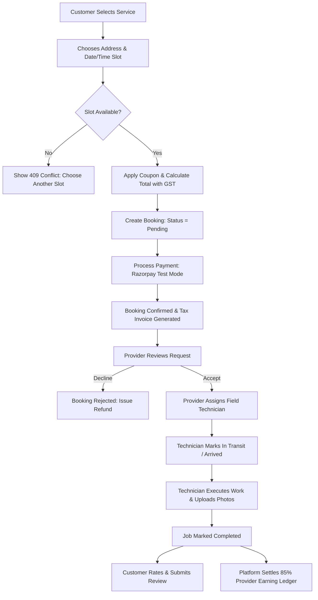
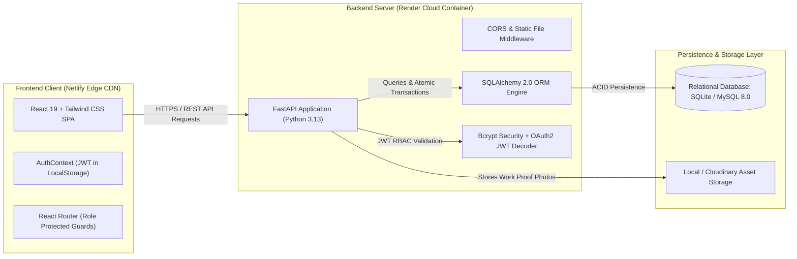

# HomeServe Technologies — Requirement Analysis & Planning Specification (SRS)

## 1. Executive Summary & Business Case
**HomeServe Technologies** is an on-demand, multi-tenant Software-as-a-Service (SaaS) Home Services Booking Platform engineered to bridge the gap between residential consumers and certified independent service contractors (electricians, plumbers, HVAC technicians, cleaners, painters, and carpenters).

### Core Problem Statement
1. **Unverified Workforce**: Consumers rely on informal phone references without identity verification, insurance, or background checks.
2. **Scheduling Friction**: Contractors lose up to 35% of billable hours managing calls and overlapping schedules.
3. **No Real-Time Visibility**: Customers cannot track service arrival times, job progress, or verifiable proof of work.
4. **Opaque Billing**: Informal cash transactions create tax non-compliance, lack warranties, and lead to unresolvable disputes.
5. **No Centralized Governance**: Platform owners lack real-time visibility into transaction volumes, commission splits, and regional service demands.

### Strategic Solution
HomeServe provides a centralized, cloud-hosted SaaS platform featuring:
- **4 Distinct Roles**: Super Admin, Service Provider (Company/Independent Contractor), Field Technician, and Customer.
- **10 Core Functional Modules**: Authentication & RBAC, Customer Management, Category/Service Catalog, Provider Dispatch, Booking Engine with Double-Booking Prevention, Technician Execution, Payment & Invoicing with Razorpay Sandbox, In-App Notifications, Review/Complaint Governance, and Global Analytics.
- **Zero-Trust Relational Architecture**: 20 normalized relational entities enforcing primary/foreign key constraints, unique indexes, and audit timestamps.

---

## 2. Software Requirements Specification (SRS)

### 2.1 Functional Requirements (FR)

| ID | Requirement | Priority | Target Role | Description |
|:---|:---|:---:|:---:|:---|
| **FR-01** | Multi-Role Authentication | Critical | All | Secure JWT token issuance with salted bcrypt password hashing and RBAC. |
| **FR-02** | Provider Onboarding & KYC | High | Admin / Provider | Verification document submission, approval/rejection workflows, and commission rate assignment. |
| **FR-03** | Service Catalog & Pricing | High | Admin / Provider | Multi-category taxonomy, service duration, base pricing, and coverage areas. |
| **FR-04** | 4-Step Booking Wizard | Critical | Customer | Address selection, service picker, date/time slot validation, and coupon application. |
| **FR-05** | Double-Booking Prevention | Critical | System | Atomic slot capacity reservation preventing duplicate appointments for the same provider time window. |
| **FR-06** | Dispatch & Job Delegation | High | Provider / Technician | Provider assigns confirmed bookings to qualified technicians with location alerts. |
| **FR-07** | Proof of Work Upload | High | Technician | Mobile-friendly image capture of before/after service proof and technician remarks. |
| **FR-08** | Payment Gateway & Invoicing | Critical | Customer / Provider | Razorpay Test Mode simulation, 18% GST tax invoice generation, and commission split calculation. |
| **FR-09** | In-App Real-Time Alerts | Medium | All | Transactional notifications for booking status updates, technician arrivals, and disputes. |
| **FR-10** | Rating & Complaint Resolution | Medium | Customer / Admin | Post-service 5-star reviews with provider replies, and formal complaint escalation to Admin. |
| **FR-11** | Business Intelligence & CSV Export | High | Admin | Real-time financial dashboards, monthly booking charts, and one-click CSV report export. |

### 2.2 Non-Functional Requirements (NFR)

| Area | Requirement | Metric / Specification |
|:---|:---|:---|
| **Performance** | API Response Latency | P95 latency < 250ms for catalog reads; < 500ms for booking transactions. |
| **Security** | Password & Token Storage | Passwords hashed using bcrypt (12 rounds); JWT access tokens encoded with SHA-256 and 24h expiration. |
| **Data Integrity** | ACID Transactions | SQLAlchemy sessions with atomic commits; slot capacity check within the same transaction. |
| **Availability** | System Uptime | 99.9% uptime target hosted across Netlify Edge CDN and Render PaaS. |
| **Scalability** | Relational Independence | Dual support for SQLite (development/embedded) and Cloud MySQL (production scale). |
| **Usability** | Responsive Design | Fully responsive mobile-first UI tested across 320px to 4K resolutions with Tailwind CSS. |

---

## 3. Comprehensive User Stories & Acceptance Criteria

### Epic 1: Authentication & User Governance
* **US-01 (Role Registration)**: *As a new visitor, I want to register as a Customer or Service Provider so that I can access personalized features.*
  * **Acceptance Criteria**: Form validates email format, mobile number (10 digits), and password strength (min 6 chars). Upon submission, passwords are encrypted with bcrypt, a verification record is created, and a welcome notification is queued.
* **US-02 (Secure Login)**: *As a registered user, I want to authenticate using my email and password so that I receive a secure session token.*
  * **Acceptance Criteria**: Returns HTTP 200 with JWT access token containing user ID and role claims. Invalid credentials return HTTP 401 Unauthorized without exposing database details.
* **US-03 (Password Reset)**: *As a user who forgot their password, I want to request a reset token so that I can regain access.*
  * **Acceptance Criteria**: User inputs registered email; system creates an alphanumeric reset token with 15-minute expiry. Submitting the valid token updates the hashed password.

### Epic 2: Service Discovery & Customer Booking
* **US-04 (Catalog Exploration)**: *As a customer, I want to browse services by category, search by keyword, and filter by price so that I find the right home repair service.*
  * **Acceptance Criteria**: Shows service thumbnail, starting price, duration, and warranty. Filter updates results in real-time.
* **US-05 (Address Book)**: *As a customer, I want to save multiple service addresses (Home, Office, Parents) so that I don't re-type them during checkout.*
  * **Acceptance Criteria**: Addresses support street line, city, state, postal code, landmark, and default flag.
* **US-06 (Double-Booking Prevention)**: *As a platform owner, I want to prevent two customers from booking the same provider in the same time slot so that providers are never double-booked.*
  * **Acceptance Criteria**: If a slot has reached capacity (1 active booking), any second booking request returns HTTP 409 Conflict with an informative error message.
* **US-07 (Coupon Application)**: *As a customer, I want to apply promo codes (`WELCOME50`, `SUMMER20`) to receive instant discounts.*
  * **Acceptance Criteria**: System validates expiration date, usage limits, and minimum booking order value. The discount is capped at `max_discount_amount`.

### Epic 3: Provider Operations & Technician Dispatch
* **US-08 (Booking Acceptance)**: *As a service provider, I want to review incoming service requests and accept or decline them based on my workload.*
  * **Acceptance Criteria**: Provider sees problem description, customer address, scheduled date/time, and estimated payout. Status changes from `pending` to `confirmed`.
* **US-09 (Technician Assignment)**: *As a service provider, I want to assign a qualified technician from my team to a confirmed booking so they can perform the job.*
  * **Acceptance Criteria**: Assignment creates a `booking_assignments` record, changes booking status to `provider_assigned`, and triggers an in-app alert for the technician.
* **US-10 (Field Execution & Status Tracking)**: *As a field technician, I want to mark my arrival and upload completion photos so that the customer and provider have verified proof of work.*
  * **Acceptance Criteria**: Technician can update assignment status to `in_transit`, `in_progress`, and `completed`. Photos are attached to `booking_images`.

### Epic 4: Payments, Billing & Financial Settlement
* **US-11 (Payment Processing)**: *As a customer, I want to pay for my service using Razorpay Test Mode or online simulation so that my booking is confirmed.*
  * **Acceptance Criteria**: Calculates subtotal + 18% GST - discount + platform fee. Upon successful payment, status updates to `paid` and an automated tax invoice (`INV-2026-XXXX`) is issued.
* **US-12 (Provider Earnings & Platform Split)**: *As a service provider, I want to track gross earnings, platform commission deductions, and net payouts.*
  * **Acceptance Criteria**: Platform automatically deducts 15% platform commission and logs net earnings in the `provider_earnings` ledger.

### Epic 5: Governance, Quality & Analytics
* **US-13 (Reviews & Responses)**: *As a customer, I want to rate my service experience from 1 to 5 stars and write a review so other users know the provider's quality.*
  * **Acceptance Criteria**: Only customers with a `completed` booking can post reviews. The provider can post an official reply.
* **US-14 (Complaint Escalation)**: *As a customer, I want to raise a complaint if a service was unsatisfactory so that Admin can mediate.*
  * **Acceptance Criteria**: Complaint is routed to Super Admin with status `open`, `investigating`, or `resolved`.
* **US-15 (Executive Analytics & CSV Export)**: *As Super Admin, I want an executive dashboard displaying total revenue, commission, user counts, and CSV export for auditing.*
  * **Acceptance Criteria**: Admin dashboard displays real-time aggregated metrics and provides an "Export Bookings CSV" button that streams a formatted spreadsheet.

---

## 4. Business Workflow & System Architecture Diagrams

### 4.1 End-to-End Booking Lifecycle Workflow

### 4.2 Platform Architecture (C4 Container View)

---

## 5. Ten Functional Modules Mapping

| # | Module Name | Primary Controller | Primary Database Entities | Core Features |
|---|:---|:---|:---|:---|
| **1** | Authentication & RBAC | `/api/v1/auth`, `/users` | `users`, `notifications` | Salted bcrypt passwords, JWT issuance, password reset, role guards. |
| **2** | Customer Management | `/api/v1/users/customer` | `customers`, `addresses` | Profile editing, multi-address management, loyalty points tracking. |
| **3** | Category & Service Catalog | `/api/v1/categories`, `/services` | `service_categories`, `services` | 8 core categories, 15 pre-seeded services, search, category filters. |
| **4** | Service Provider Management | `/api/v1/providers` | `service_providers`, `provider_services`, `service_areas` | KYC verification, commission rate settings, service area boundaries. |
| **5** | Booking & Slot Engine | `/api/v1/bookings` | `bookings`, `availability_slots` | 4-step wizard, double-booking prevention, status lifecycle. |
| **6** | Technician Dispatch | `/api/v1/technicians` | `technicians`, `booking_assignments`, `booking_images` | Job assignments, work proof photos, arrival/completion timestamps. |
| **7** | Payment & Invoicing | `/api/v1/payments` | `payments`, `invoices`, `coupons`, `provider_earnings` | Razorpay simulation, 18% GST calculation, automated tax invoice. |
| **8** | Notifications System | `/api/v1/notifications` | `notifications` | In-app alerts, unread counts, mark-as-read, booking reminders. |
| **9** | Ratings & Complaints | `/api/v1/reviews`, `/complaints` | `reviews`, `complaints` | 5-star ratings, provider replies, dispute ticket resolution. |
| **10** | Analytics & Reporting | `/api/v1/analytics` | All 20 Relational Tables | Global revenue, platform commissions, monthly trends, CSV export. |
